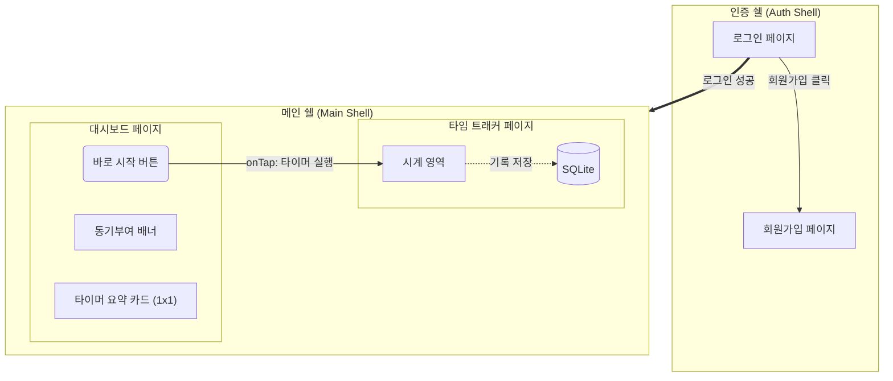
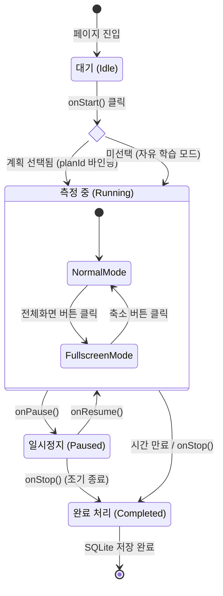
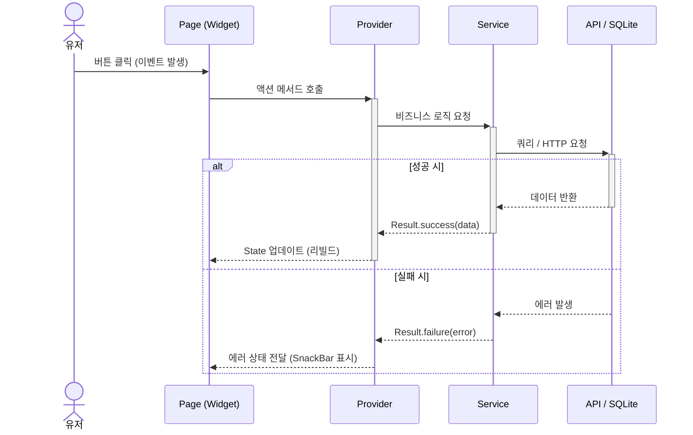
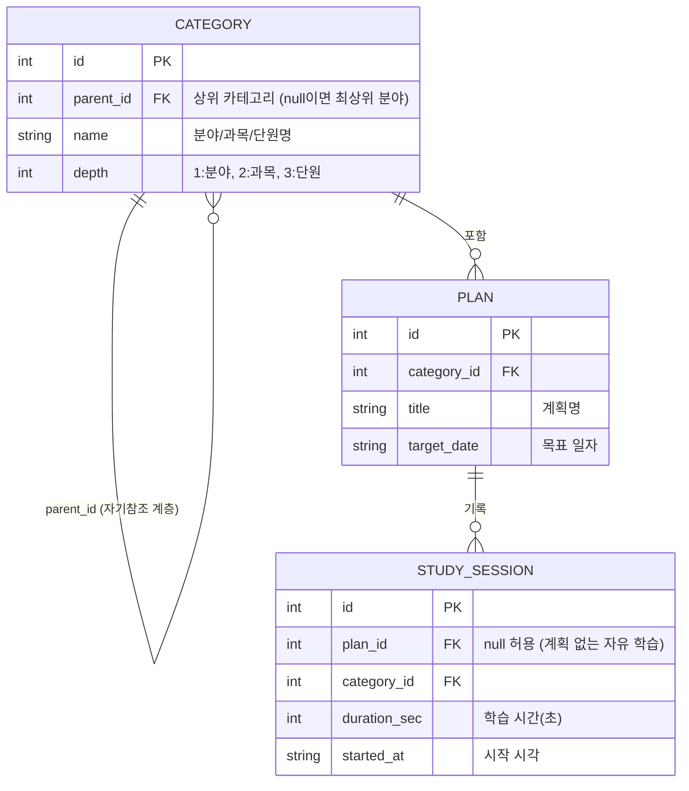
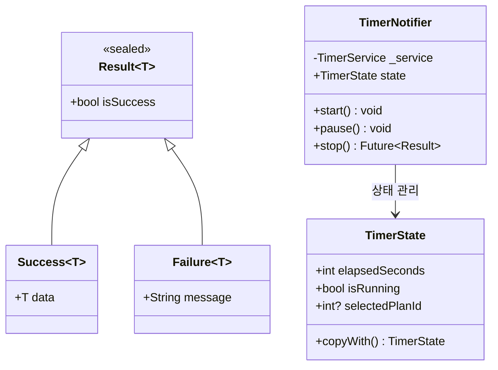
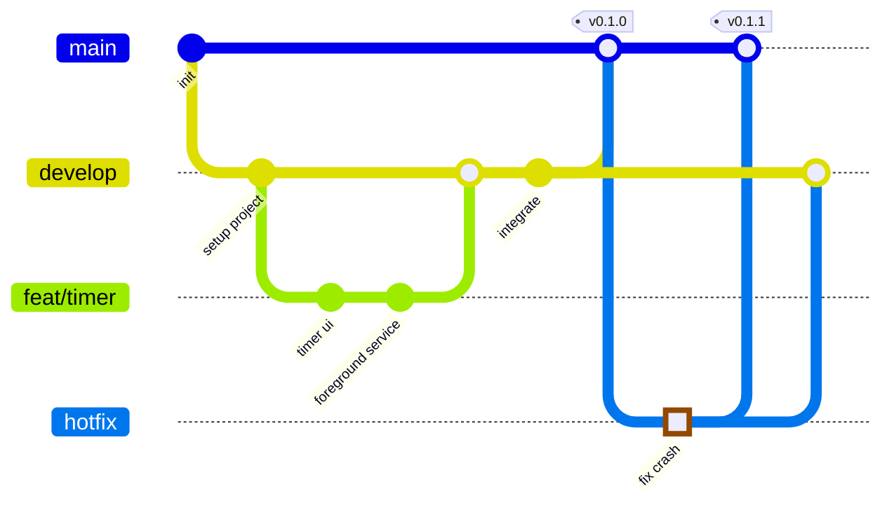
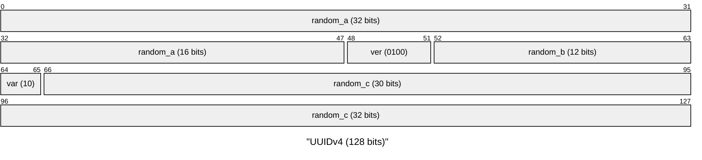
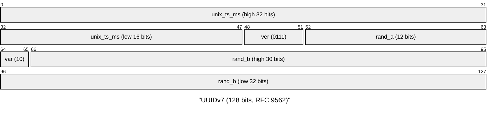
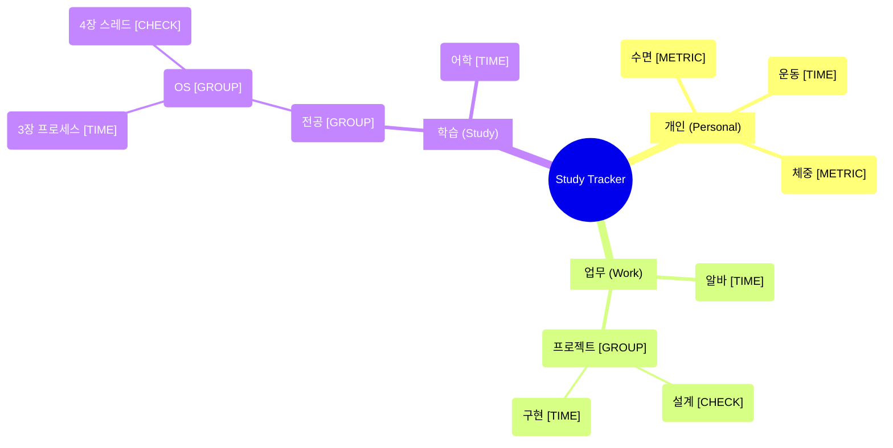

# Mermaid 기초 레퍼런스 (.md / .mmd)

> - 스펙(Spec) 문서에서 화면 구조, 상태 전이, 데이터 흐름, DB 스키마를 정의할 때 복붙해 쓰는 기본 문법 정리
> - from gemini argon
> - extension : `Markdown Preview Mermaid Support`
> - Link : [Mermaid](https://mermaid.js.org/)

## 0. 공통 규칙 및 문법 에러 방지 수칙

- **작성 방식**
    - 마크다운(`.md`) 내부: ` ```mermaid \r\n``` ` 코드블록 안에 작성
    - 단독 파일(`.mmd`): 백틱 없이 첫 줄에 다이어그램 선언어(`flowchart TD` 등)부터 작성
- **주석**: 줄 앞에 `%%` 작성 (`%% 주석 내용`)
- **문법 에러 방지 3대 규칙**
    - **큰따옴표 필수**: 표시할 이름에 띄어쓰기, 한글, 괄호(`()`, `[]`), 콜론(`:`), 슬래시(`/`)가 들어가면 반드시 `ID["표시할 텍스트"]`처럼 큰따옴표로 감싼다.
    - **예약어 ID 금지**: 노드 ID를 소문자 `end`로 지으면 블록 종료 예약어와 충돌한다. (`END`, `EndNode` 등으로 작성)
    - **화살표 라벨 따옴표**: 화살표 설명에도 특수문자가 들어가면 `-->|"onTap(id)"|`처럼 큰따옴표로 감싼다.

---

## 1. Flowchart (`flowchart`) — 화면 영역 중첩 & 이동 흐름

### 방향 선언
- `flowchart TD` (또는 `TB`): 위 → 아래 (Top-Down)
- `flowchart BT`: 아래 → 위 (Bottom-Top)
- `flowchart LR`: 왼쪽 → 오른쪽 (Left-to-Right)
- `flowchart RL`: 오른쪽 → 왼쪽 (Right-to-Left)

### 노드(박스) 모양
- `A["사각형: 일반 페이지 / 위젯 / 영역"]`
- `B("둥근 사각형: 버튼 / 입력 / 액션")`
- `C(["캡슐형: 시작 / 종료 / 외부 진입점"])`
- `D{"마름모: 조건 분기 (if / switch)"}`
- `E[("원통형: SQLite / DB / Storage")]`
- `F[["서브루틴: 외부 서비스 / API 모듈"]]`

### 연결선(화살표) 종류
- `A --> B` : 실선 화살표 (일반 이동 / 직접 호출)
- `A -->|"이벤트 / 조건"| B` : 라벨이 붙은 실선 화살표
- `A -.-> B` : 점선 화살표 (모달 호출 / 간접 참조 / 설정 이동)
- `A -.->|"비동기 / 참조"| B` : 라벨이 붙은 점선 화살표
- `A ==> B` : 굵은 화살표 (핵심 메인 플로우)
- `A <--> B` : 양방향 화살표
- `A --- B` : 화살표 없는 단순 연결선

### 복붙용 템플릿 (Shell / Page / Widget 중첩 구조)



---

## 2. State Diagram (`stateDiagram-v2`) — 상태 머신 & 이벤트 전이

### 핵심 문법
- **시작과 끝**: `[*] --> 초기상태`, `종료상태 --> [*]`
- **상태 별칭 지정**: `state "화면에 보일 한글 이름" as StateID`
- **이벤트 전이**: `StateA --> StateB : 이벤트명 / 실행 액션`
- **중첩(복합) 상태**: `state 상위상태ID { ... }`
- **동시(병렬) 영역 구분**: 상태 블록 내부에 `--` 줄을 그어 독립적으로 돌아가는 하위 상태를 나눔
- **조건 분기**: `state 분기ID <<choice>>` 선언 후 화살표 연결
- **메모 부착**: `note right of StateID : 메모 내용` (방향: `left of`, `right of`)

### 복붙용 템플릿 (타이머 / 비동기 상태 전이)



---

## 3. Sequence Diagram (`sequenceDiagram`) — 레이어 간 호출 순서

### 핵심 문법
- **참여자 선언**
    - `actor User as 유저` (사람 모양 아이콘)
    - `participant UI as 페이지(Widget)` (일반 박스)
    - `participant Prov as 프로바이더(Riverpod)`
    - `participant Svc as 서비스(Logic)`
    - `participant DB as SQLite / API`
- **화살표 종류**
    - `A->>B: 메시지` (실선 화살표: 요청 / 함수 호출)
    - `B-->>A: 메시지` (점선 화살표: 응답 / 반환값)
    - `A->>+B: 호출` / `B-->>-A: 반환` (`+`, `-`로 실행 중 활성화 막대 표시)
- **제어 블록**
    - `alt 조건A` ~ `else 조건B` ~ `end` : 성공/실패 등 조건 분기
    - `opt 조건` ~ `end` : 단일 조건일 때만 실행 (if문)
    - `loop 반복조건` ~ `end` : 반복 실행

### 복붙용 템플릿 (UI → Provider → Service → API/DB)



---

## 4. ER Diagram (`erDiagram`) — SQLite 테이블 및 관계 설계

### 관계 기호 (좌측과 우측에 조합하여 사용)
- `||` : 정확히 1개 (One)
- `|o` 또는 `o|` : 0개 또는 1개 (Zero or One)
- `}|` 또는 `|{` : 1개 이상 (One or More)
- `}o` 또는 `o{` : 0개 이상 (Zero or More)
- **자주 쓰는 조합**
    - `A ||--o{ B : "1:N 관계"` (A 하나에 B가 0개 이상 연결)
    - `A ||--|{ B : "1:N 필수 관계"` (A 하나에 B가 최소 1개 이상 연결)

### 복붙용 템플릿 (테이블 정의 및 FK 연결)



---

## 5. Class Diagram (`classDiagram`) — 모델(DTO) & 객체 구조

### 핵심 문법
- **접근 제어자**: `+` (Public), `-` (Private), `#` (Protected)
- **관계 화살표**
    - `Parent <|-- Child` : 상속 (`extends`)
    - `Interface <|.. Impl` : 인터페이스 구현 (`implements`)
    - `Container *-- Item` : 강한 포함 (Composition)
    - `Caller --> Target` : 참조 및 의존 (Dependency)

### 복붙용 템플릿 (State / Service / Repository 관계)



---

## 6. Git Graph (`gitGraph`) — 브랜치 & 병합 흐름

### 핵심 문법
- **방향 선언**: `gitGraph` (기본 가로 `LR`), 세로 방향은 `gitGraph TB:` 또는 `gitGraph BT:`
- **커밋 생성**: `commit` / `commit id: "커밋명"` / `commit tag: "v1.0.0"`
- **커밋 강조**: `commit type: HIGHLIGHT` (`NORMAL`, `REVERSE`, `HIGHLIGHT`)
- **브랜치 생성 및 이동**
    - `branch 브랜치명` : 현재 커밋에서 새 브랜치 생성 후 이동
    - `checkout 브랜치명` (또는 `switch 브랜치명`) : 기존 브랜치로 이동
- **병합 & 체리픽**
    - `merge 브랜치명` : 현재 브랜치로 대상 브랜치 병합 (`tag: "..."` 병기 가능)
    - `cherry-pick id: "커밋ID"` : 특정 커밋만 현재 브랜치로 가져오기

### 복붙용 템플릿 (기능 개발 & 릴리즈 흐름)



---

## 7. Packet Diagram (`packet-beta`) — 비트 / 패킷 구조

### 핵심 문법
- **선언**: `packet-beta` (기본 32비트 폭, 0부터 비트 인덱스 시작)
- **필드 정의**
    - `시작비트-끝비트: "필드명"` (예: `0-31: "unix_ts_ms"`)
    - 단일 비트: `64-64: "flag"` 또는 `+1: "flag"`
- **제목**: 첫 줄에 `title "제목"` 표기 가능

### 복붙용 템플릿 (UUIDv4 vs UUIDv7 128-bit 구조 비교)

#### UUIDv4 (완전 랜덤 기반)


#### UUIDv7 (Unix Timestamp + 랜덤, 시간순 정렬 가능)


---

## 8. Mindmap (`mindmap`) — 계층 마인드맵

### 핵심 문법
- **선언**: `mindmap`
- **계층 표현**: 화살표 없이 **들여쓰기(Indentation, 보통 2칸 또는 4칸)**만으로 부모-자식 관계 표현
- **노드 모양**
    - `root((루트))` : 원형 (중심 루트)
    - `id["사각형"]` : 사각형
    - `id("둥근 사각형")` : 둥근 사각형
    - `id{{"육각형"}}` : 육각형
    - 들여쓰기만 하고 기호 없이 일반 텍스트 작성도 가능

### 복붙용 템플릿 (다계층 노드 트리 예시)



---

## 9. TreeView (`treeView-beta`) — 디렉토리 / 파일 트리 구조

> Mermaid v11.14.0+ 지원 (기존 `Markdown Preview Mermaid Support` 구버전 엔진에서는 렌더링되지 않을 수 있음)

### 핵심 문법
- **선언**: `treeView-beta`
- **계층 표현**: 들여쓰기(Indentation)만으로 부모-자식 디렉토리 구조 표현
- **라벨 규칙**: 공백이 없으면 따옴표 없이 작성(`src/`), 공백이 포함되면 큰따옴표(`"my folder/"`) 사용
- **부가 기능**
    - `## 주석` : 노드 오른쪽에 인라인 설명 추가
    - `:::highlight` : 특정 노드 강조
    - `icon(none)` / `icon(패키지:아이콘)` : 아이콘 표시 제어 (`config.treeView.showIcons: true` 필요)

### 복붙용 템플릿 (프로젝트 디렉토리 구조 예시)


